<h1 align="center">Olá, eu sou Eduardo Tonatto</h1>

  

  

  Desenvolvedor Full Stack e estudante de Engenharia de Software na UniBrasil.
  Já entreguei mais de 100 sites e desenvolvi um CRM usado em produção.
   
  <strong>Busco estágio ou vaga júnior como desenvolvedor (Curitiba, híbrido ou remoto).</strong>

  
  
  

---

## Sobre mim

- Desenvolvedor Full Stack na Agência Gemini Marketing Digital: mais de 100 sites desenvolvidos e 56 projetos ativos sob minha manutenção.
- Backend em PHP, modelagem e otimização de bancos de dados relacionais (SQL), interfaces responsivas e WordPress.
- Projetos próprios com Next.js, Supabase, Tailwind CSS, APIs REST, automações em Python e deploy na Vercel.
- Base em Java e Python pela faculdade.
- Antes da programação, trabalhei como SDR e com licitações públicas: isso me deu visão de negócio, comunicação com clientes e organização de processos.
- Curitiba, Paraná, Brasil.

## Projetos em destaque

| Projeto | O que é | Stack |
| --- | --- | --- |
| **Funil** | CRM da Agência Gemini para gerenciar leads e o funil de vendas: integração via API com o BotConversa (WhatsApp), automações em Python para reengajar leads, quadro Kanban e calendário de tarefas. | Next.js · Supabase · Tailwind CSS · Python · Vercel |
| **ByFlame** | Sistema de controle financeiro de vendas, comissões, salários e sites, com login por papel: cada empresa vê só os próprios resultados (Row Level Security). | Next.js · Supabase (PostgreSQL e Auth) · Tailwind CSS · Vercel |
| **Sistema de Biblioteca** | Projeto Integrador de Programação Avançada (UniBrasil), feito em equipe e construído em etapas incrementais. | Java · POO |
| **[Portfólio](https://eduardotonattodev.com.br)** | Meu site de desenvolvedor, com projetos, stack e contato. | Desenvolvimento web |

> Os repositórios do Funil e do ByFlame são privados porque guardam dados de clientes e dados financeiros. Posso mostrar o código e uma demonstração em entrevista.

## Tecnologias que utilizo

  
  
  
  
  
  
  
  
  
  
  
  
  
  

## Ferramentas

  
  
  
  
  

## GitHub Stats

  

  <picture>
    <source media="(prefers-color-scheme: dark)" srcset="https://raw.githubusercontent.com/ElTonatto/ElTonatto/output/github-contribution-grid-snake-dark.svg" />
    <source media="(prefers-color-scheme: light)" srcset="https://raw.githubusercontent.com/ElTonatto/ElTonatto/output/github-contribution-grid-snake.svg" />
    
  </picture>

## Experiência

**Desenvolvedor Full Stack** · Agência Gemini Marketing Digital · set/2025 até hoje
- Mais de 100 sites desenvolvidos para clientes, com 56 projetos ativos sob minha manutenção.
- Sistemas web em PHP, com modelagem de bancos relacionais e consultas SQL otimizadas para produção.
- Interfaces responsivas com HTML, CSS, JavaScript e Vue.js.
- Desenvolvimento e customização de sites WordPress (temas e plugins).
- Idealizei e desenvolvi o Funil, o CRM da agência (Next.js, Supabase, Tailwind CSS e Vercel).

**Experiências anteriores:** SDR na Alpha Media, técnico de licitação e analista de suporte N1 na DIXI Soluções.

## Formação e idiomas

- Engenharia de Software · UniBrasil Centro Universitário (em andamento)
- Técnico em Energias Renováveis · CEEP Newton Freire Maia
- Português: nativo · Espanhol: avançado · Inglês: básico a intermediário

## Certificações

- 50 Projects In 50 Days: HTML, CSS & JavaScript (Udemy)
- Modern HTML & CSS From The Beginning 2.0 (Udemy)

## Vamos conversar

Estou buscando minha próxima oportunidade como desenvolvedor. Se quiser conversar sobre uma vaga ou um projeto:

  
  
  

